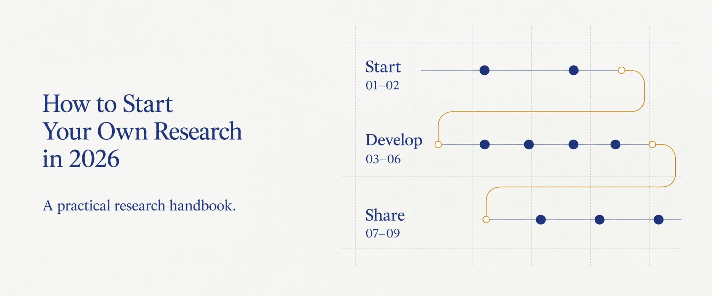

# How to Start Your Own Research in 2026

A practical Chinese-language handbook connecting project organization, literature, experiments, writing, and manuscript collaboration. Follow nine chapters across three stages, or start with the research task in front of you.

**[Read →][handbook]** · [Chapters](#chapters) · [Search][search] · [简体中文](README.md)

[][handbook]

[![Nine chapters][badge-chapters]][chapters] [![29 reusable AI prompts][badge-prompts]][handbook] [![16 frequently asked questions][badge-questions]][questions] [![Handbook language: Chinese][badge-language]][handbook]

The handbook is in Chinese. This English README is a guide to its contents.

## Start with your current task

For a first read, begin with [01 · ChatGPT and Skills][chapter-01], then [02 · Projects and Context Management][chapter-02]. Understand the working modes, then establish consistent locations for materials, code, and manuscripts.

If you already have a project, choose the task you need to address:

| Your current task | Start here |
| --- | --- |
| Set up or resume a project | [02 · Projects and Context][chapter-02] |
| Find a direction and manage citations | [03 · Literature][chapter-03] · [04 · References][chapter-04] |
| Plan and track an experiment | [05 · Experiments][chapter-05] |
| Write, compile, and sync a paper | [06 · Writing][chapter-06] · [07 · Git and Overleaf][chapter-07] |
| Revise, present, or adapt | [08 · Review and Talks][chapter-08] · [09 · Workflow][chapter-09] |

## Nine chapters, one research route

### Getting started · 01–02

- **[01 · ChatGPT and Skills][chapter-01]** Understand Chat, Work, and Codex modes, local and cloud tasks, and how to select, install, and check Skills, plugins, and tool connections.

- **[02 · Projects and Context Management][chapter-02]** Establish a project directory, organize materials and paper repositories, and preserve records so the next session can continue the work.

### Developing the research · 03–06

- **[03 · Literature and Research Gaps][chapter-03]** Define the question, find and verify sources, compare the closest existing work, record candidate gaps, and plan an initial check.

- **[04 · Zotero and References][chapter-04]** Import literature, verify metadata, manage citation keys, export BibTeX or BibLaTeX, and check citations in the manuscript.

- **[05 · Experiment Design and Records][chapter-05]** Define questions, comparisons, and evaluation methods. Record protocols and analysis plans, then preserve each run and any changes.

- **[06 · Writing and Figures][chapter-06]** Build an outline from research materials, draft and revise within a defined scope, use verified citations, create figures from data, and inspect the layout.

### Collaboration and communication · 07–09

- **[07 · Git and Overleaf][chapter-07]** Set up a paper repository and local LaTeX, inspect remote changes and diffs, compile before synchronization, and resolve conflicts.

- **[08 · Review, Revision, and Presentations][chapter-08]** Identify manuscript issues, prioritize revisions, organize reviewer comments and responses, and prepare presentations from existing research materials.

- **[09 · Adapting Your Workflow][chapter-09]** Identify repeated work and missing records, decide where information belongs, evaluate small changes, and update progress and handover notes.

## Read, find, and put it to use

- **Find a section and keep reading.** Full-text search locates tasks and tools. Chapter menus, page contents, and previous/next links support continuous reading, with expandable navigation on small screens.

- **Bring prompts into your own project.** Expand and copy 29 AI prompts, then replace the placeholders. Each prompt specifies the scope, materials to inspect, and expected result.

- **Learn through concrete examples.** Five chapters contain 16 expandable FAQs, supported by research illustrations, comparison tables, directory layouts, and sample records.

[View the Chinese-language reading interface](previews/handbook.jpg) · [Tools and references][resources]

<strong>Which tools and methods are covered?</strong>

| Task | Tools or methods |
| --- | --- |
| Working with AI | ChatGPT's Chat, Work, and Codex modes, Skills, plugins, and tool connections, with related Claude Code projects. |
| Organizing projects and records | Research-Workflow-Skills, planning-with-files, project directories, and records across sessions. |
| Finding and managing literature | Knows, grilling, Zotero, Better BibTeX, source verification, and comparison with existing work. |
| Writing, figures, and communication | Academic-Paper-Skills, presentation and peer-review Skills, manuscript review, and revision records. |
| Version control and manuscript collaboration | Git, GitHub, LaTeX, latexmk, and Overleaf, with local compilation, diff inspection, and remote synchronization. |

Start with the tools your task needs and adjust as you use them. Consult official documentation and project instructions for installation, available features, and permissions. Links are collected under [tools and sources][resources].

Tools and prompts can help with specific tasks. Research decisions, source verification, and the final content remain the reader's responsibility.

## Questions and suggestions

For a broken link, outdated content, or an unclear step, [open an issue][issues]. Include the chapter or section link and describe the problem. Add the tool version and observed behavior when relevant.

[Start reading][handbook] · [All chapters][chapters] · [Cover notes](previews/visuals.md)

[handbook]: https://delong-l.github.io/Research-Workflow-2026/
[chapters]: https://delong-l.github.io/Research-Workflow-2026/#chapters
[search]: https://delong-l.github.io/Research-Workflow-2026/search/
[resources]: https://delong-l.github.io/Research-Workflow-2026/resources/
[questions]: https://delong-l.github.io/Research-Workflow-2026/guide/agents-skills/#questions
[chapter-01]: https://delong-l.github.io/Research-Workflow-2026/guide/agents-skills/
[chapter-02]: https://delong-l.github.io/Research-Workflow-2026/guide/project-workspace/
[chapter-03]: https://delong-l.github.io/Research-Workflow-2026/guide/literature-gaps/
[chapter-04]: https://delong-l.github.io/Research-Workflow-2026/guide/references/
[chapter-05]: https://delong-l.github.io/Research-Workflow-2026/guide/experiments/
[chapter-06]: https://delong-l.github.io/Research-Workflow-2026/guide/writing-figures/
[chapter-07]: https://delong-l.github.io/Research-Workflow-2026/guide/git-overleaf/
[chapter-08]: https://delong-l.github.io/Research-Workflow-2026/guide/review-sharing/
[chapter-09]: https://delong-l.github.io/Research-Workflow-2026/guide/your-workflow/
[issues]: https://github.com/DELONG-L/Research-Workflow-2026/issues
[badge-chapters]: https://img.shields.io/badge/Chapters-9-303c66?style=flat-square
[badge-prompts]: https://img.shields.io/badge/AI_prompts-29-303c66?style=flat-square
[badge-questions]: https://img.shields.io/badge/FAQ-16-303c66?style=flat-square
[badge-language]: https://img.shields.io/badge/Handbook-Chinese-303c66?style=flat-square
