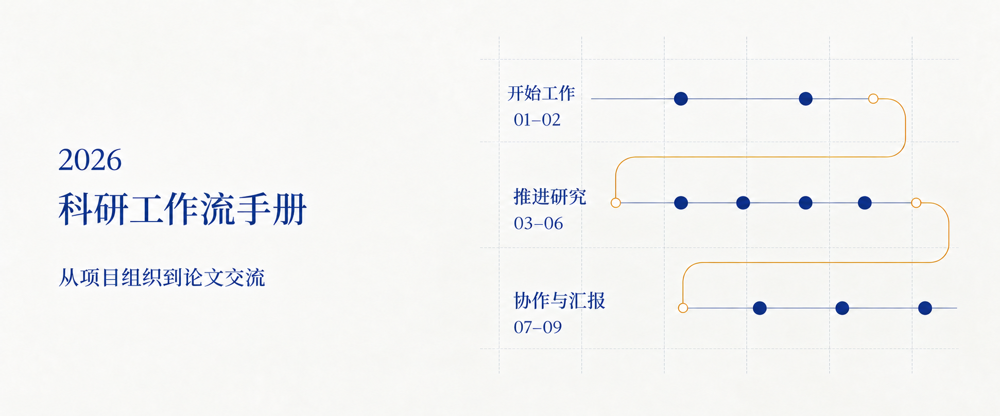

# How to Start Your Own Research in 2026

一本中文科研工作流实践手册，串起项目组织、文献、实验、写作与论文协作。九章内容按三个阶段展开，也可以从眼前的研究任务开始查阅。

**[在线阅读 →][handbook]** · [九章目录](#chapters) · [站内搜索][search] · [English](README.en.md)

[][handbook]

[![九章手册][badge-chapters]][chapters] [![29 条 AI 操作指令][badge-prompts]][handbook] [![16 个常见问题][badge-questions]][questions] [![正文语言：中文][badge-language]][handbook]

正文为中文；英文 README 提供导读。

## 从当前任务开始

第一次阅读，建议先看 [01 · ChatGPT 与 Skill][chapter-01]，再看 [02 · 项目与上下文管理][chapter-02]：先了解工作方式，再为材料、代码和论文确定稳定的存放位置。

已有项目时，可以直接选择当前需要处理的任务：

| 你正在做什么 | 从这里读起 |
| --- | --- |
| 新建项目，或继续上次的工作 | [02 · 项目与上下文管理][chapter-02] |
| 找研究方向，整理文献与引用 | [03 · 文献与研究空白][chapter-03] · [04 · Zotero 与参考文献][chapter-04] |
| 确定实验方案，检查运行记录 | [05 · 实验设计与记录][chapter-05] |
| 写论文、做图表，编译与同步文稿 | [06 · 写作与图表][chapter-06] · [07 · Git 与 Overleaf][chapter-07] |
| 处理审稿意见，准备汇报或调整流程 | [08 · 审查、修回与汇报][chapter-08] · [09 · 调整工作流程][chapter-09] |

## 九章，一条研究路线

### 开始工作 · 01–02

- **[01 · ChatGPT 与 Skill][chapter-01]** 了解 Chat、Work 与 Codex 模式，区分本地和云端任务，选择、安装并检查 Skill、插件与工具连接。

- **[02 · 项目与上下文管理][chapter-02]** 确定项目目录，组织材料与论文仓库，保存跨会话记录，方便下次继续。

### 推进研究 · 03–06

- **[03 · 文献与研究空白][chapter-03]** 明确研究问题，检索并核对原文，比较最接近的已有工作，记录候选研究空白并安排初步验证。

- **[04 · Zotero 与参考文献][chapter-04]** 导入文献、核实元数据、管理引用键，导出 BibTeX 或 BibLaTeX，并检查正文引用。

- **[05 · 实验设计与记录][chapter-05]** 说明实验问题、比较条件与评价方法，记录方案和分析计划，保留每次运行与方案变化。

- **[06 · 写作与图表][chapter-06]** 从研究材料整理论文提纲，在明确范围内起草与修改，使用已核实的引用，从数据制作图表并检查排版。

### 协作与汇报 · 07–09

- **[07 · Git 与 Overleaf][chapter-07]** 建立论文仓库与本地 LaTeX 环境，读取远端变化、检查差异和编译结果，再同步文稿并处理冲突。

- **[08 · 审查、修回与汇报][chapter-08]** 找出稿件的主要问题，安排修改顺序，整理审稿意见与回复，用已有研究材料准备汇报。

- **[09 · 调整工作流程][chapter-09]** 检查重复操作和记录缺失，确定信息的维护位置，评估小范围调整，更新进展与交接记录。

## 边读边用

- **查得到，也接得上。** 全文搜索可按任务或工具定位内容；章节目录、页内目录和前后篇导航帮助连续阅读，小屏设备也可展开目录。

- **把指令带回自己的项目。** 29 条 AI 操作指令可以展开和复制，替换占位信息后使用。每条指令说明任务范围、所需材料与预期结果。

- **结合例子理解操作。** 16 个可展开的常见问题分布在五章中，配合场景插画、对照表、目录结构与记录示例，解释具体做法。

[查看实际阅读界面](previews/handbook.jpg) · [工具与参考来源][resources]

<strong>手册涉及哪些工具与方法？</strong>

| 任务 | 工具或方法 |
| --- | --- |
| 与 AI 协作 | ChatGPT 的 Chat、Work 与 Codex 模式，Skill、插件与工具连接，以及 Claude Code 相关项目。 |
| 整理项目与工作记录 | Research-Workflow-Skills、planning-with-files，项目目录与跨会话记录。 |
| 检索、阅读与管理文献 | Knows、grilling、Zotero、Better BibTeX，原文核对与已有工作比较。 |
| 写作、图表与研究交流 | Academic-Paper-Skills，研究汇报、同行评审与修回相关 Skill。 |
| 版本管理与论文协作 | Git、GitHub、LaTeX、latexmk 与 Overleaf，本地编译、差异检查与远端同步。 |

先选择当前任务需要的工具，再根据使用情况调整。安装方式、可用功能与权限以官方说明及对应项目文档为准，入口汇总在[工具与来源][resources]。

工具与指令可以辅助具体工作，研究判断、来源核实与最终内容仍需由读者负责。

## 问题与建议

发现失效链接、过时内容或不清楚的步骤，欢迎[提交 Issue][issues]。请附章节或小节链接，并说明遇到的问题；涉及工具操作时，可补充工具版本与实际现象。

[开始阅读][handbook] · [全部章节][chapters] · [封面说明](previews/visuals.md)

[handbook]: https://delong-l.github.io/Research-Workflow-2026/
[chapters]: https://delong-l.github.io/Research-Workflow-2026/#chapters
[search]: https://delong-l.github.io/Research-Workflow-2026/search/
[resources]: https://delong-l.github.io/Research-Workflow-2026/resources/
[questions]: https://delong-l.github.io/Research-Workflow-2026/guide/agents-skills/#questions
[chapter-01]: https://delong-l.github.io/Research-Workflow-2026/guide/agents-skills/
[chapter-02]: https://delong-l.github.io/Research-Workflow-2026/guide/project-workspace/
[chapter-03]: https://delong-l.github.io/Research-Workflow-2026/guide/literature-gaps/
[chapter-04]: https://delong-l.github.io/Research-Workflow-2026/guide/references/
[chapter-05]: https://delong-l.github.io/Research-Workflow-2026/guide/experiments/
[chapter-06]: https://delong-l.github.io/Research-Workflow-2026/guide/writing-figures/
[chapter-07]: https://delong-l.github.io/Research-Workflow-2026/guide/git-overleaf/
[chapter-08]: https://delong-l.github.io/Research-Workflow-2026/guide/review-sharing/
[chapter-09]: https://delong-l.github.io/Research-Workflow-2026/guide/your-workflow/
[issues]: https://github.com/DELONG-L/Research-Workflow-2026/issues
[badge-chapters]: https://img.shields.io/badge/Chapters-9-303c66?style=flat-square
[badge-prompts]: https://img.shields.io/badge/AI_prompts-29-303c66?style=flat-square
[badge-questions]: https://img.shields.io/badge/FAQ-16-303c66?style=flat-square
[badge-language]: https://img.shields.io/badge/Handbook-%E4%B8%AD%E6%96%87-303c66?style=flat-square
